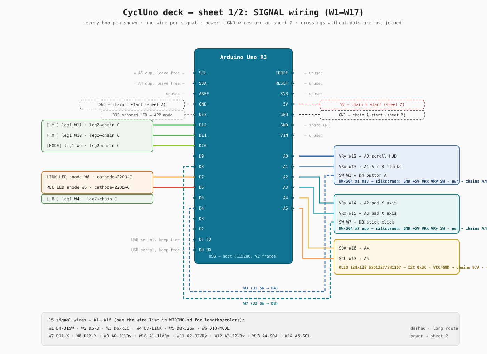
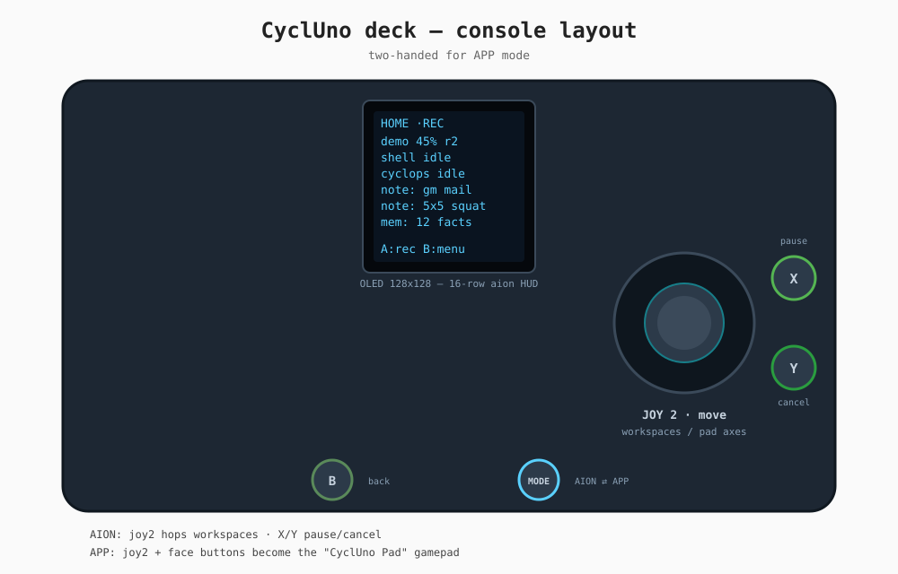

# CyclUno

Cyclops dev unit on an Arduino Uno — deck edition. Two jobs, one breadboard:

1. **Cyclops dev unit** — the wearable product at breadboard scale: joystick
   + buttons + SPI TFT + LEDs, wired to the brain over USB serial. No WiFi/BT —
   the cable substitutes the radio while exercising the exact same v2 frame
   protocol and the exact same brain pipeline (transcriber → extractor →
   notes → HUD frames).
2. **aion control deck** — the physical console for the
   [aion](https://github.com/ilPez00/aion) cockpit TUI: two thumb
   joysticks, four face buttons, a mode switch. In AION mode the deck
   navigates the cockpit one-handed; in APP mode it becomes a Linux gamepad
   (uinput "CyclUno Pad") driving whatever program aion spawned. The SPI TFT
   mirrors aion status. Jarvis, but with detents.

The cyclops brain side (SerialLink, `demo_cycluno.py`, bash TUI) lives in the
[cyclops](https://github.com/ilPez00/cyclops-wearable) repo; the aion deck
host side lives in aion (`src/aion/deck/`). This repo is the firmware only.
Wire protocol: `include/cyclops_shared.h` (kept in sync with cyclops
`firmware/lib/cyclops_shared`); input-event payloads: `include/deck.h`
(pinned byte-for-byte to aion's `deck/protocol.py` by `test/test_deck.cpp`).

## Why an Uno when the XIAO exists
- Input bring-up without risking the wearable board.
- The ATmega328P's 2 KB SRAM forces the lean-HUD discipline
  (`sizeof(UnoHud)` gated < 400 B by the host tests).
- Anything proven here (input handling, frame flow, pipeline) transfers
  upstream unchanged, because the wire protocol is shared.

## Wiring



Full assembly guide — BOM, step-by-step order (each step leaves a working
unit), rules the wiring relies on, troubleshooting: **[docs/WIRING.md](docs/WIRING.md)**.

Quick pin map: confirmed 128×128 SPI TFT (ST7735, 1.44 in)
TFT D11 MOSI/SDA · D13 SCK/SCL · D10 CS · D9 DC · RES→3.3V via 10k · BL→3.3V/VCC per module
joy1 A0/A1+D4 · joy2 A2/A3+D8 · B D5 · MODE D2 · X D3 · Y D12 · LEDs D6/D7 ·
APP LED A4 (external; D13 is now TFT clock). Everything beyond joy1 + B is optional: unwired pins
read as unpressed (internal pullups) and the unit degrades to the original
single-stick HUD.



### Controls — AION mode (A4 LED off)
Local HUD: **stick 1 up/down** scrolls · **stick 1 right / SW** = A (REC
toggle on HOME, select in MENU) · **stick 1 left / button B** = menu/back.
Forwarded to the aion cockpit: **joy2** = navigate workspaces · **X** = pause ·
**Y** = cancel · **stick 2 click** = activate.

### Controls — APP mode (MODE button toggles, A4 LED on)
The deck is a gamepad: **stick 2** = analog axes · **A/B/X/Y + both stick
clicks + wheel click** = buttons · **joy2** = navigate. aion exposes it as a
uinput device named "CyclUno Pad"; spawn a program (`run app mpv …`) and play.

Keep both sticks at rest during boot — those readings become the calibrated
centers. If a direction feels flipped for your module's mounting, set
`JOY_FLIP_Y` / `JOY_FLIP_X` in `src/main.cpp`.

## Build + flash
```
make test     # host gate: HUD logic + joystick nav + deck logic + wire contract
make build    # pio run -e cycluno
make flash    # pio run -e cycluno -t upload
```

`make test` ends with a **wire-contract gate**: `src/main.cpp` must still
reference `cyclops_shared.h` / `encode_frame` / `MSG_INPUT_EVENT`. The library
tests cover `include/*.h` (Arduino-free, host-compilable); `main.cpp` is not,
so it was the one file nothing guarded — and it is the file that owns the link
to aion. A `main.cpp` that stops emitting frames leaves `DeckLink` alive but
deaf, with no error anywhere.

### The other firmware: `mouse`
`src/mouse.cpp` is a **separate, simpler build** — one joystick + one button +
an MPU6050, no display, plain ASCII lines (`M dx dy`, `L 1/0`, `G <n>`) at
115200. It is a standalone HID-style pointer, **not** a deck: it does not speak
the framed protocol and aion cannot drive it. Own wiring
([docs/WIRING-MOUSE.md](docs/WIRING-MOUSE.md) — MPU6050 on A4/A5, joystick on
A0/A1/D2, button D3), own env.

```
make mouse    # pio run -e mouse -t upload && monitor
```

## Run the wired brain
From the cyclops repo:
```
python3 demo_cycluno.py       # auto-picks /dev/ttyACM*|ttyUSB*
```
Press **A** on the unit: the driver "transcribes" the next prerecorded take
through the real pipeline and streams the extracted notes back as NOTE frames
onto the SPI TFT.
